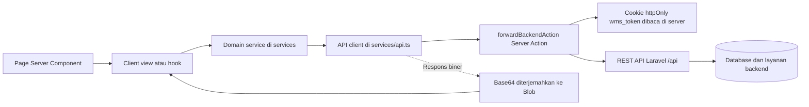

# Wildlife Monitoring System — Frontend

Dokumentasi berbasis kode sumber untuk `wildlife-tracking-frontend`. Pemeriksaan terakhir: 2026-11-28.

## 1. Ringkasan Proyek

Repository ini berisi klien web untuk Wildlife Monitoring System Balai Taman Nasional Gunung Leuser (BTNGL). Aplikasi dibangun dengan Next.js App Router dan menyajikan dashboard konservasi, pengelolaan data master, pelacakan GPS, pelaporan insiden, analisis media berbantuan AI, wisata, pemesanan tiket, serta kasir loket (POS).

Frontend bukan tempat penyimpanan data dan bukan otoritas keamanan. Aplikasi ini tidak terhubung langsung ke database, tidak memanggil penyedia AI secara langsung, tidak menyimpan kunci AI, dan tidak menentukan hasil validasi atau izin secara final. Seluruh data persisten dan keputusan otorisasi berasal dari API Laravel di repository `wildlife-tracking-backend`.

Teks antarmuka sebagian besar menggunakan bahasa Indonesia. Tersedia pula mode bahasa Inggris melalui `lib/i18n.ts` dan `lib/auto-translate.ts`.

## 2. Fitur Utama

- Login staf dan pendaftaran pengunjung dengan tantangan aritmetika serta honeypot dari backend.
- Navigasi dan pembatasan rute berbasis enam role dan lima belas permission di sisi antarmuka.
- Dashboard, statistik, pusat notifikasi dengan polling jumlah pesan belum dibaca, dan peta GPS langsung yang melakukan polling setiap 10 detik.
- Halaman CRUD untuk spesies, satwa, perangkat, zona geografi, insiden, kunjungan zona, pengguna, role/permission, log aktivitas, cuaca, laporan agregat, dan ekspor.
- Modul AI: unggah media, riwayat dan detail prediksi, antrean verifikasi, daftar ancaman, rekap, laporan ringkasan, galeri media, galeri wajah staf, dan foto referensi satwa.
- Katalog wisata, rute tur dengan peta 2D/3D, pemandu dan jadwal shift, pemesanan pengunjung dan bukti pembayaran, check-in tiket, serta pengelolaan administratif.
- Sesi kasir POS, penjualan, pembatalan, riwayat sesi, laporan harian, dan struk HTML yang dicetak melalui iframe sandboxed.
- Ensiklopedia spesies publik dengan model 3D GLB yang disajikan melalui proxy Laravel.
- Sistem komponen bersama, tabel responsif, tema terang/gelap, pengaturan ukuran teks dan kontras, widget perintah suara, serta panduan pengguna di dalam aplikasi.

## 3. Tumpuan Teknologi

Versi diambil dari `package.json`; rentang `^` ditampilkan apa adanya.

| Area | Teknologi |
| --- | --- |
| Framework | Next.js `^16.4.6` — App Router, Server Components, Server Actions |
| UI | React dan React DOM `19.2.8` |
| Bahasa | TypeScript `^5`, `strict: true`, `noEmit: true`, alias `@/*` ke root repository |
| Styling | Tailwind CSS `^4` dengan `@tailwindcss/postcss`; konfigurasi CSS di `app/globals.css` |
| Pengambilan data | TanStack Query `^5.104.4` |
| Tabel | TanStack Table `^8.21.3` |
| Form dan validasi | React Hook Form `^7.90.0`, `@hookform/resolvers` `^5.9.2`, Zod `^4.6.7` |
| Peta dan 3D | Leaflet `^1.9.4`, MapLibre GL `^6.19.0`, Three.js `^0.183.2`, `@google/model-viewer` `^4.4.0` |
| Ikon dan QR | `lucide-react` `^1.60.0`, `qrcode` `^1.5.4` |
| Utilitas | `clsx`, `tailwind-merge` |
| Lint | ESLint `^9` dengan `eslint-config-next` `16.3.8` |
| HTTP | `fetch` bawaan, terpusat di `services/api.ts`; tidak ada Axios |

Tidak ada test runner frontend, tidak ada skrip `typecheck`, dan tidak ada pustaka komponen eksternal. Skrip `predev` dan `prebuild` menjalankan `scripts/check-deps.mjs` untuk memastikan paket terpasang sesuai `package-lock.json`.

## 4. Arsitektur Sistem



Fakta arsitektur penting:

- File `app/**/page.tsx` adalah Server Components. Komponen interaktif berada di folder rute atau di `components/`.
- `app/layout.tsx` membungkus aplikasi dengan `PreferencesProvider`, `QueryProvider`, dan `ToastProvider`, serta memasang `VoiceA11yWidget` secara global.
- `app/(protected)/layout.tsx` memverifikasi sesi di server melalui `GET /api/me` dan mengalihkan ke `/login?reason=...` bila sesi tidak ada, kedaluwarsa, tidak valid, atau backend tidak dapat dihubungi. Route group tidak memengaruhi URL.
- Satu-satunya file Server Action adalah `services/backend-actions.ts`. Tidak ada `app/api/`, tidak ada route handler Next.js, dan tidak ada `middleware.ts`.
- `services/api.ts` memiliki resolusi base URL, query string, timeout, `ApiError`, pembacaan JSON, serta pengodean dan dekodean berkas biner. Modul lain tidak melakukan `fetch` langsung.
- Komponen tidak berbicara langsung dengan database, penyedia AI, atau Laravel selain melalui service dan API client yang ditentukan.

## 5. Integrasi Frontend–Backend

### Alur Permintaan

Hook memanggil domain service, service memanggil `api` dari `services/api.ts`, lalu `api` meneruskan method, path, parameter, body atau `FormData`, header, dan timeout kepada `forwardBackendAction()`. Server Action ini membaca cookie httpOnly `wms_token`, menambahkan header `Authorization: Bearer <token>`, memvalidasi path, dan memanggil Laravel. Token tidak pernah dikirim ke JavaScript browser.

`isSafeApiPath()` hanya menerima path relatif yang diawali `/` dan memuat huruf, angka, `/`, `_`, `.`, dan `-`. Traversal, skema URL, query string, fragmen, karakter kontrol, dan `@` ditolak. Permintaan tanpa token menghasilkan 401 lokal.

Permintaan publik tertentu, seperti challenge pendaftaran, login, register, dan logout, memakai `createServerApiClient()` secara langsung di sisi server. Server Action meneruskan `X-Forwarded-For` dari entri paling kanan agar rate limit Laravel dihitung per pengunjung. Backend hanya mempercayai header itu bila alamat server Next.js terdaftar di `TRUSTED_PROXIES`.

### Base URL

`getLaravelApiBaseUrl()` dalam `services/api.ts` memilih, secara berurutan:

1. `API_URL` — hanya di server, prioritas tertinggi.
2. `NEXT_PUBLIC_API_URL` — fallback untuk konfigurasi publik.
3. `http://127.0.0.1:8000/api` — nilai bawaan.

Tailing slash dibuang. Path service bersifat relatif terhadap base URL tersebut, misalnya `/animals` dan `/ai/upload`. Setiap rute backend juga tersedia pada prefiks `/api/v1/...`, tetapi frontend memakai bentuk tanpa prefiks.

### Respons, Error, dan Pagination

- Envelope umum: `{ success, message, data, errors, meta? }`; `unwrapData()` mengambil `data`.
- Endpoint daftar mengembalikan array di `data`. Metadata pagination dibaca dari `X-Total-Count`, `X-Current-Page`, `X-Per-Page`, dan `X-Last-Page`. Beberapa service menyusun metadata cadangan dengan `buildFallbackMeta()` bila header tidak tersedia.
- `ApiError` memuat `status`, `kind` (`unauthorized`, `forbidden`, `validation`, `not_found`, `client`, `server`, `network`, `unknown`), serta field error dari objek `errors` Laravel. `formatApiError()` dan `getApiFieldErrors()` dipakai form alert dan `ErrorState`.
- `QueryProvider` memakai `staleTime` 30 detik, tidak melakukan refetch saat jendela fokus, dan hanya mencoba ulang satu kali untuk kegagalan non-4xx. Setiap 401 pada query maupun mutation memanggil `logoutAction()` lalu mengarahkan ke `/login?reason=expired`.
- Timeout bawaan 10 detik. Permintaan AI memakai 30 detik atau 120 detik untuk unggah, retry, pengambilan berkas, laporan, dan deteksi. Permintaan voice chat memakai 15 detik.

### Unggah dan Respons Biner

`FormData` diteruskan tanpa header `Content-Type` agar boundary multipart dibuat otomatis. `next.config.ts` menaikkan batas body Server Action menjadi `55mb` untuk media AI hingga 50 MB. Respons biner seperti gambar, video, audio, CSV, GeoJSON, PDF, dan GLB dikodekan base64 oleh Server Action lalu diterjemahkan menjadi `Blob` di browser melalui `getBlob()`.

### Catatan Integrasi Terverifikasi

- Login, register, logout, `/me`, pembaruan profil, dan perubahan kata sandi sesuai dengan controller auth Laravel. Frontend membaca `data.token`, `data.user`, dan role dari `data.user.role.role_name` atau `name_role`.
- Payload dan verb CRUD sesuai dengan rute dan validasi backend untuk satwa, spesies, perangkat, zona geografi, insiden, pengguna, role, wisata, POS, dan AI.
- Otorisasi backend berbasis permission (`permission:...`). Tabel permission di frontend mencerminkan seeder backend, tetapi hanya berlaku untuk antarmuka; otoritas tetap di Laravel.
- `services/voice-assistant.service.ts` memanggil `POST /voice-assistant/chat`, yang tidak terdaftar dalam `routes/api.php` saat ini. Widget memiliki interpreter perintah lokal sebagai fallback. Ini adalah celah integrasi yang diketahui.
- Live Map memakai data API nyata dengan polling GPS setiap 10 detik, bukan WebSocket. Nilai dashboard dan statistik diagregasi di browser dari endpoint daftar.

## 6. Struktur Direktori

```text
wildlife-tracking-frontend/
├── app/
│   ├── (protected)/               rute terautentikasi, layout, view, dan helper
│   ├── login/                     halaman dan form login
│   ├── register/                  pendaftaran pengunjung
│   ├── error.tsx                  layar error nivel rute
│   ├── not-found.tsx              layar 404 nivel rute
│   ├── globals.css                Tailwind, token tema, CSS responsif dan cetak
│   └── layout.tsx                 layout akar dan provider global
├── components/
│   ├── accessibility/             widget suara dan aksesibilitas visual
│   ├── data-table/                pembungkus TanStack Table
│   ├── navigation/main/           app shell, sidebar, header, mobile nav, tema
│   ├── notifications/             popup notifikasi langsung
│   ├── providers/                 query, toast, dan preferences provider
│   ├── tourism/                   peta rute 2D/3D, QR, simulator pembayaran, safety UI
│   ├── tracking/                  peta langsung dan detail satwa
│   ├── ui/                        panel, modal, loading, empty/error state, stat card
│   └── wildlife/                  penampil model 3D dan badge IUCN
├── hooks/                         hook TanStack Query per domain
├── lib/                           sesi, navigasi, cookie, i18n, perintah suara, utilitas
├── services/                      API client, Server Action, auth, dan service domain
├── types/                         kontrak domain, API, dan Server Action
├── utils/                         formatter dan helper unduhan
├── public/                        aset statis
├── scripts/check-deps.mjs         pemeriksaan dependensi untuk dev dan build
├── eslint.config.mjs
├── next.config.ts
├── postcss.config.mjs
└── tsconfig.json
```

Direktori hasil build dan dependensi tidak sengaja dimasukkan dalam daftar di atas.

## 7. Modul Aplikasi

Rute di bawah `(protected)` memerlukan autentikasi. URL lama `/master-data/{animals,species,devices,geo-zones}` dan pola `/{module}/:id/update` ditulis ulang oleh `next.config.ts` ke rute saat ini.

| Modul | Rute utama | Perilaku yang diimplementasikan |
| --- | --- | --- |
| Publik | `/`, `/login`, `/register` | Redirect sesuai role, login dengan pesan alasan, pendaftaran pengunjung dengan CAPTCHA |
| Ringkasan | `/dashboard`, `/statistics`, `/manual` | Ringkasan dari backend, statistik dihitung di browser, panduan aplikasi |
| Monitoring | `/tracking/live-map`, `/notifications`, `/weather`, `/emergency-contacts` | Peta Leaflet dengan polling GPS, notifikasi dan badge belum dibaca, cuaca dan sinkronisasi Open-Meteo, kontak darurat |
| Data master | `/animals`, `/species`, `/devices`, `/geo-zones` | Daftar, detail, tambah, dan ubah; operasi/token perangkat; pengelolaan model 3D spesies di `/species/[id]/model` |
| Data lapangan | `/incidents`, `/zone-visits`, `/reports`, `/exports` | CRUD insiden dan lampiran, pembuatan kunjungan zona, laporan agregat, unduhan CSV/GeoJSON |
| AI | `/ai/vision`, `/ai/vision/history`, `/ai/vision/pending`, `/ai/vision/[id]/detail`, `/ai/media`, `/ai/threats`, `/ai/recap`, `/ai/reports`, `/ai/staff-faces` | Unggah dan analisis, antrean verifikasi, galeri media dan ancaman, rekap, laporan ringkasan, galeri wajah staf |
| Administrasi | `/users`, `/roles`, `/activity-logs`, `/profile` | Pengelolaan pengguna dan token, matriks role-permission, log audit, profil dan kata sandi sendiri |
| Wisata pengunjung | `/tours`, `/tours/[id]/detail`, `/tours/[id]/create`, `/guides`, `/guides/[id]/detail`, `/bookings`, `/bookings/[id]/detail`, `/tours/map-3d` | Katalog, itinerary dan informasi keselamatan, quote dan pemesanan, bukti pembayaran, e-tiket QR, ulasan, peta rute 3D |
| Wisata loket | `/tourism/check-in`, `/pos`, `/pos/sessions`, `/pos/sessions/[id]/detail` | Check-in tiket QR/manual, sesi dan penjualan kasir, riwayat sesi, struk |
| Wisata admin | `/tourism/routes`, `/tourism/guides`, `/tourism/shifts`, `/tourism/prices`, `/tourism/reviews`, `/tourism/bookings`, `/tourism/payments`, `/pos/report` | CRUD rute, pemandu, shift, tarif, dan hari libur; moderasi pemesanan dan pembayaran; laporan POS harian |

Halaman tambah dan ubah merupakan rute terpisah. Sebagian besar modul memakai helper `column.tsx`, `filter.tsx`, dan form yang berada di folder rute yang sama.

## 8. Autentikasi dan RBAC

### Alur Sesi

1. `loginAction()` atau `registerAction()` memanggil Laravel melalui `laravel-auth.service.ts` dan menerima `{ success, data: { user, token } }`.
2. `setAuthCookies()` menulis `wms_session` dan `wms_token` sebagai cookie httpOnly dengan `sameSite: "lax"`, `path: "/"`, `secure` saat produksi, dan masa berlaku 8 jam.
3. `getVerifiedSession()` memanggil `GET /api/me` dengan token sebelum halaman terlindungi dirender.
4. `forwardBackendAction()` menambahkan bearer token untuk semua permintaan API operasional.
5. `logoutAction()` memanggil `POST /api/logout` dan tetap menghapus cookie lokal walaupun pencabutan token backend gagal.

### Role dan Permission

Role didefinisikan di `types/auth.type.ts`:

| Role | Permission di frontend |
| --- | --- |
| `administrator_sistem` | seluruh 15 permission |
| `peneliti_ekologi` | `view_data`, `create_data`, `update_data`, `view_reports`, `manage_master_data`, `upload_media`, `verify_ai`, `export_data` |
| `konservasionis_lapangan` | `view_data`, `create_data`, `update_data`, `upload_media`, `verify_ai`, `validate_tickets` |
| `pengambil_kebijakan` | `view_data`, `view_reports`, `upload_media`, `export_data` |
| `petugas_loket` | `sell_tickets`, `validate_tickets` |
| `pengunjung` | `book_tickets` |

Kelima belas permission tersebut adalah `view_data`, `create_data`, `update_data`, `delete_data`, `manage_users`, `manage_roles`, `view_reports`, `manage_master_data`, `upload_media`, `verify_ai`, `export_data`, `book_tickets`, `manage_tourism`, `validate_tickets`, dan `sell_tickets`.

`lib/navigation.ts` menyusun menu dari permission dan `canAccessRoute()` membatasi rute tulis. `app-shell.tsx` menampilkan panel akses ditolak untuk path yang tidak diizinkan. Rute bawaan adalah `/dashboard` untuk staf konservasi, `/pos` untuk kasir, dan `/tours` untuk pengunjung.

**Seluruh pemeriksaan ini hanya bersifat UX.** Laravel memberlakukan permission sebenarnya pada setiap rute API.

## 9. Integrasi API

Semua path berikut bersifat relatif terhadap base URL `/api`.

| Area | Endpoint yang dipakai frontend |
| --- | --- |
| Auth | `GET /register/challenge`, `POST /login`, `POST /register`, `POST /logout`, `GET /me`, `PATCH /me`, `PUT /me/password` |
| Data master | `GET/POST /species`, `/animals`, `/devices`, `/geo-zones`, `/incidents`, detail `/{id}`, serta `PUT`, `DELETE`, status, assignment, dan telemetry |
| Pelacakan | `GET /gps-readings`, `GET /animals/{id}/track`, `GET /animals/{id}/zone-visits`, `GET /geo-zones/{id}/animals`, `/visits`, `/devices`, `GET /geo-zones/locate` |
| Data lapangan | `GET/POST /animal-geo-zone-visits`, `GET/POST/PUT/DELETE /incidents`, `GET/POST /incidents/{id}/media`, `GET /weather-data`, `POST /weather-data/sync` |
| Dashboard | `GET /dashboard`, `/dashboard/stats`, `/dashboard/charts` |
| AI | `POST /ai/upload`, `GET /ai-predictions`, `/pending-verification`, `/{id}`, `POST /ai-predictions/{id}/verify`, `/retry`, `DELETE /ai-predictions/{id}`, `GET /media-uploads` beserta route berkas dan prediksinya, `GET /ai/summary-report`, `/recap`, `/health`, `/threats`, `/vocabulary`, `POST /ai/detect-objects`, wajah staf, dan foto referensi satwa |
| Laporan | `GET/POST /aggregate-reports`, `POST /aggregate-reports/generate`, `GET /aggregate-reports/{id}/download`, `GET /export/*` |
| Administrasi | `GET/POST/PUT/PATCH/DELETE /users`, `/roles`, `/permissions`, `/staff-faces`, `GET /activity-logs`, token dan aktivitas pengguna |
| Notifikasi | `GET /notifications`, `/unread-count`, `/{id}`, `PATCH /{id}/read`, `/read-all`, `DELETE /notifications`, `/{id}` |
| Wisata | katalog/quote/payment-info publik; `GET/POST /visitor/bookings*`; check-in; rute, pemandu, shift, tarif, hari libur, pemesanan, pembayaran, dan ulasan admin |
| POS | `GET /pos/session`, `POST /pos/session/open`, `/close`, `GET /pos/sessions`, `/sales`, `POST /pos/sales`, void, `GET /pos/report` |
| Wildlife 3D | `GET /wildlife/species`, `/{id}`, `/{id}/model`, `POST/DELETE /species/{id}/model` |
| Voice | `POST /voice-assistant/chat` — lihat Keterbatasan |

Query string diserialisasi di `services/api.ts`. Nilai `undefined`, `null`, string kosong, dan `"all"` dihilangkan. Sorting dan pagination backend tersedia, tetapi sebagian besar daftar masih melakukan pagination pada data yang sudah diambil.

## 10. Variabel Lingkungan

Tidak ada `.env.example` yang di-commit. Buat `.env.local` secara manual.

| Variabel | Fungsi |
| --- | --- |
| `API_URL` | Base URL Laravel hanya di server, prioritas tertinggi |
| `NEXT_PUBLIC_API_URL` | Base URL fallback bila `API_URL` kosong |
| `NEXT_PUBLIC_COOKIE_TOKEN` | Nama cookie token; bawaan `wms_token` |
| `NEXT_PUBLIC_COOKIE_EXPIRES_AT` | Nama cookie tambahan yang dihapus saat logout; bawaan `wms_expires_at` |
| `NEXT_PUBLIC_COOKIE_TYPE` | Nama cookie tambahan yang dihapus saat logout; bawaan `wms_type` |
| `NEXT_PUBLIC_MAP_SATELLITE_URL` | Template tile satelit MapLibre |
| `NEXT_PUBLIC_MAP_SATELLITE_ATTRIBUTION` | Atribusi tile satelit |
| `NEXT_PUBLIC_MAP_STREET_URL` | Template tile jalan |
| `NEXT_PUBLIC_MAP_TERRAIN_URL` | Template tile elevasi/terrain |
| `NEXT_PUBLIC_MAP_LABELS_URL` | Template overlay label |
| `NEXT_PUBLIC_MAP_ROADS_URL` | Template overlay jalan |
| `NEXT_PUBLIC_MAP_TOPO_URL` | Template topografi |
| `NODE_ENV` | Diatur Next.js; mengontrol flag `secure` cookie |

Nilai `NEXT_PUBLIC_*` terlihat oleh browser. Jangan pernah menaruh kunci API, bearer token, atau rahasia penyedia di dalamnya. Penyedia tile peta dihubungi langsung oleh browser; gunakan layanan berlisensi untuk produksi dengan traffic besar.

## 11. Instalasi

Persyaratan: Node.js 20.9 atau lebih baru dan npm. Backend Laravel harus berjalan agar halaman berbasis data dapat digunakan.

```powershell
cd wildlife-tracking-frontend
npm install
```

Buat `.env.local` minimal dengan:

```env
API_URL=http://127.0.0.1:8000/api
```

## 12. Alur Pengembangan

1. Pasang dan jalankan backend sesuai [README backend](../wildlife-tracking-backend/README.md), termasuk `php artisan serve` pada port 8000.
2. Jalankan `npm install` setelah setiap perubahan `package.json` atau `package-lock.json`; `predev` akan menolak start bila dependency tidak sinkron.
3. isi `API_URL` di `.env.local` dengan root API Laravel.
4. Jalankan `npm run dev` dan buka `http://localhost:3000`.

## 13. Menjalankan Aplikasi

```bash
npm run dev
npm run build
npm run start
npm run lint
```

`npm run dev` dan `npm run build` terlebih dahulu menjalankan pemeriksaan dependency.

## 14. Lint dan Pemeriksaan Tipe

```bash
npm run lint
npx tsc --noEmit
```

`npm run lint` dapat melaporkan peringatan `react-hooks/incompatible-library` dari TanStack Table. Tidak ada skrip `npm run typecheck`.

## 15. Build Produksi

`npm run build` menghasilkan build Next.js untuk produksi. Atur URL backend melalui `API_URL` atau `NEXT_PUBLIC_API_URL` dan akhiri TLS di proxy platform. Karena aplikasi memakai cookie httpOnly, frontend dan backend harus dapat dijangkau dari sesi browser yang sama. Jika keduanya berbeda origin, atur `FRONTEND_URLS` pada backend.

## 16. Pengujian

Tidak ada test suite frontend, runner unit/integration, maupun harness end-to-end di repository ini. Verifikasi dilakukan dengan `npx tsc --noEmit`, `npm run lint`, `npm run build`, dan pemeriksaan manual di browser terhadap backend Laravel yang berjalan. Pengujian otomatis backend berada di `wildlife-tracking-backend/tests`.

## 17. Catatan Deployment

- Pakai URL backend yang stabil. Alur Cloudflare Tunnel dijelaskan di [`docs/DEPLOY.md`](../wildlife-tracking-backend/docs/DEPLOY.md); quick tunnel akan berganti URL saat restart.
- Server Action memerlukan runtime Node.js dengan dukungan `Buffer` dan `fetch`.
- Pertahankan `experimental.serverActions.bodySizeLimit` minimal setara batas unggah backend, yaitu 50 MB.
- Tabel role-permission di `types/auth.type.ts` harus selaras dengan `database/seeders/RolePermissionSeeder.php` di backend agar menu konsisten. Permission backend tetap menjadi otoritas.

## 18. Keterbatasan Diketahui

- `POST /voice-assistant/chat` tidak memiliki rute backend. Widget memakai interpreter perintah lokal sebagai fallback.
- Pemeriksaan role dan rute hanya di sisi klien. Pengguna yang mengetahui path API tetap dibatasi oleh Laravel.
- Beberapa daftar menyusun metadata pagination sendiri dan sebagian besar tabel melakukan pagination pada data yang sudah diambil.
- Alert perangkat dan beberapa angka dashboard dihitung di browser dari endpoint daftar, bukan dari endpoint khusus.
- `/tracking/live-map` melakukan polling setiap 10 detik, bukan streaming real-time.
- Tidak ada `.env.example` dan tidak ada pengujian otomatis frontend.
- Media dan ekspor besar melewati proxy Server Action sebagai base64 sehingga meningkatkan penggunaan memori.
- Catatan lama yang menyebut `/wildlife-3d`, `/wildlife-explorer`, "Drunk Mode", `components/shared/form-page.tsx`, atau `/ai/vision/[id]` tidak sesuai dengan struktur sumber saat ini. Path yang diimplementasikan adalah `/species/[id]/model`, `/tracking/live-map`, helper rute yang berada di folder terkait, dan `/ai/vision/[id]/detail`.

## 19. Kontributor

Frontend: Yohana Sinaga. Backend dan dokumentasi: Yohanna Purnomo. Database: Nuevalen dan Laura. AI dan integrasi: Farrellino. Tim mengembangkan proyek dengan Scrum; lihat `../AGENTS.md` dan `../PROJECT-DEVELOPMENT-GUIDELINE.md` untuk konvensi dan riwayat proyek.
